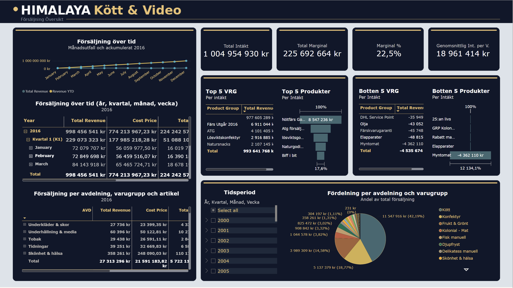
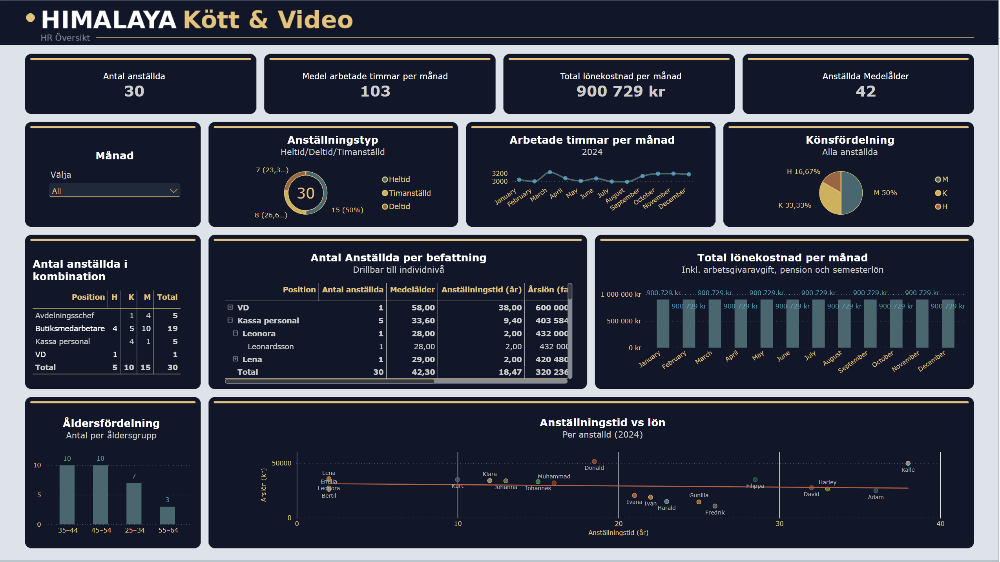
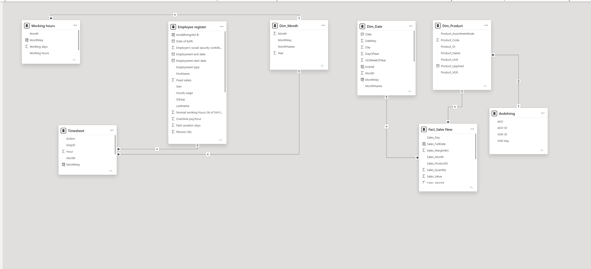

  

  
  
  
  

## 📌 The brief

Himalaya Kött & Video is a retail business selling everything from meat and groceries to confectionery, tobacco and media. The client wanted a Power BI report to follow up **sales** and **HR**, based on a written requirements specification (*kravställning*).

My job: turn their questions into a clear, interactive report that a store manager could open and understand in under a minute.

---

## 💰 Sales overview

| Requirement | Solution |
|---|---|
| KPIs: revenue, margin (kr and %), average revenue per week | Four KPI cards across the top |
| Sales, cost price and margin for the whole business, per department, product group and article | Drillable matrix: department → product group → article |
| Top 5 and bottom 5 product groups and products | Four Top N visuals (tables + bar charts) |
| Sales over time, monthly and accumulated over the year | Line chart with monthly revenue and **YTD** |
| Sales by year, quarter, month and week | Date-hierarchy matrix + time period slicer |
| Each department's and product group's share of total sales (drillable) | Drillable pie chart |

**Key findings**
- Overall margin is **22.5%**.
- **Kött** (meat) is the biggest category at about **42%** of sales, followed by confectionery and fruit & vegetables.
- **Nötfärs** (minced beef) is the top-selling single product.
- Some product groups, such as *Myntomat* and *DHL Service Point*, show **negative revenue**. These look like service or cash-handling flows rather than real product sales, and should be checked with the client before drawing conclusions.

---

## 👥 HR overview

| Requirement | Solution |
|---|---|
| Number of employees, individually and combined | KPI card + matrix by position and gender (M/K/H) |
| Drillable from position down to individual | Matrix with drill-down: position → employee, with age, tenure and annual salary |
| Gender, age, employment type, annual salary | Gender pie, age group chart, employment type donut |
| Hours worked per month + monthly average | Line chart + KPI card |
| Pie chart showing the employee distribution | Gender distribution pie |
| How long have people worked here, and does tenure affect salary? | Scatter plot of tenure vs. annual salary with a trend line |
| Salary cost per month (incl. employer fees, pension, holiday pay) | Column chart + KPI card |
| Filter by month | Month slicer |

**Key findings**
- **30 employees** with an average age of **42**; half work full time.
- The trend line in *Tenure vs. salary* is almost flat: **tenure does not appear to drive salary** here. Some of the longest-serving staff earn less than newer colleagues, which could be worth raising in a salary review.

---

## 🛠️ How it was built

The model has two star schemas in one file:

- **Sales:** `Fact_Sales` (revenue, quantity, margin) linked to `Dim_Date` and `Dim_Product`, with `Avdelning` attached to products so sales can be drilled from department → product group → article
- **HR:** `Timesheet` (hours per employee and month) linked to `Employee register` (salary, hourly wage, employment type, pension, employer fees) and `Dim_Month`, with `Working hours` giving the available hours per month

**DAX** measures cover margin and margin %, YTD revenue, average revenue per week, Top N / Bottom N ranking, average age, tenure, and total salary cost including employer fees, pension and holiday pay.

**Design:** consistent dark theme with gold accents, KPI cards at the top, and drill-down so the report goes from overview to detail.
